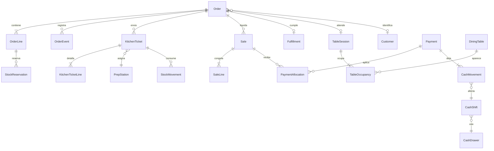

# Modelo de datos

Estado: **Propuesto**. Revisión: 2026-11-06, operación mixta.

No hay tablas físicas ni migraciones. Este modelo es el que deberá cubrirse en la primera migración cuando exista aprobación formal, para no agregar el salón y el domicilio como un parche.

Convenciones: UUID versión 7; `organization_id`; `branch_id` en lo operativo; dinero en centavos `bigint`; cantidades en decimal con unidad; fechas en UTC; libros de solo inserción; versión entera en pedido, saldo, mesa y turno.

## 1. Pedido

**Order**

- `channel`: `COUNTER`, `DINE_IN`, `DELIVERY`, `PICKUP`
- `fulfillment_status`: `DRAFT`, `OPEN`, `IN_PREPARATION`, `READY`, `FULFILLED`, `CANCELLED`
- `settlement_status`: `UNPAID`, `PARTIALLY_PAID`, `PAID`, `VOID`
- `version`
- `opened_by_user_id`, `owner_user_id`
- `customer_id` nulo
- `table_session_id` nulo
- `promised_at` nulo
- `opened_at`, `closed_at`

Checks: `DINE_IN` pasado de borrador exige sesión. Los otros canales no llevan sesión. `DELIVERY` y `PICKUP` confirmados exigen cliente. `PICKUP` confirmado exige `promised_at`.

**OrderLine**

- producto, variante nula, cantidad
- `guest_label` nulo
- `status`: `DRAFT`, `SENT`, `IN_PREPARATION`, `READY`, `HANDED_TO_SERVICE`, `FULFILLED`, `CANCELLED`
- `inventory_effect`: `NONE`, `RESERVED`, `CONSUMED`, `REVERSED`, `WASTED`
- precio unitario cotizado, descuento autorizado, usuario autorizador
- costo teórico congelado, nulo hasta el envío
- motivo de cancelación

**OrderLineModifier**: modificador, cantidad, delta de precio, snapshot de insumos.

**OrderCharge**: `DELIVERY_FEE` u otro cargo sin receta, monto en centavos.

**OrderEvent**: tipo, actor, fecha, referencia. Solo inserción. Cubre alta, adición, envío, traslado, unión, división, pago, cumplimiento y cancelación.

## 2. Comanda

**PrepStation**: sede, nombre, tipo `KITCHEN` o `BAR`, activa. El MVP siembra una.

**Product.default_station_id**: nulo. La cola única ignora el enrutamiento; el dato evita otra migración.

**KitchenTicket**

- pedido, sede, estación
- `kind`: `FIRE`, `ADDITION`, `CANCEL`
- `sequence` por pedido
- `status`: `QUEUED`, `IN_PREPARATION`, `READY`, `HANDED_TO_SERVICE`, `CANCELLED`
- `idempotency_key`
- usuario y fecha de envío

**KitchenTicketLine**: comanda, línea de pedido, cantidad, nombre y modificadores en el momento del envío.

**KitchenTicketEvent**: cambio de estado, motivo, actor. Solo inserción.

Unicidad: una llave de envío no crea dos comandas. La cancelación no elimina la comanda original.

## 3. Venta y pago

**Sale**

- pedido, sede, estado `POSTED` o `VOIDED`
- totales congelados: bruto de productos, descuento, impuestos, cargos y total de la venta. La propina no entra en ese total. El desglose candidato está en la sección 12 y en `PAYMENT_AND_CASH_RULES.md`
- usuario, fecha, llave de idempotencia

**SaleLine**: venta, línea de pedido, cantidad liquidada, montos congelados.

**SaleTax**: tributo, base, tasa en puntos básicos, monto.

**SaleVoid**: venta, motivo, autorizador, fecha.

**Payment**

- sede, turno de caja
- `target`: `SALE` o `ORDER`
- medio `CASH`, `CARD`, `TRANSFER`
- monto y propina en centavos
- `status`: `RECORDED` o `VOIDED`
- referencia externa, para tarjeta y transferencia
- llave de idempotencia
- usuario

**PaymentAllocation**: pago, venta, monto. El anticipo nace sin asignación y queda `OPEN`, `APPLIED` o `REFUNDED`.

Checks: la suma de cantidades liquidadas y no anuladas de una línea no supera la cantidad activa. La suma de asignaciones de una venta publicada cubre su total. Un pago `RECORDED` tiene al menos un movimiento de caja.

## 4. Caja

**CashDrawer**: sede, nombre, activa. Puede haber varias. El MVP opera una.

**CashShift**: caja, cajero, monto inicial, estado `OPEN` o `CLOSED`, versión. Una caja tiene a lo sumo un turno abierto.

**CashMovement**: turno, tipo (`OPENING`, `TENDER`, `TIP`, `DEPOSIT`, `REFUND`, `EXPENSE`, `MANUAL_IN`, `MANUAL_OUT`), medio, monto, documento origen. Solo inserción.

**CashCount**: turno, medio, monto contado.

**ShiftClose**: cabecera del cierre y diferencia consolidada. El detalle por medio está en la sección 12. Terminal.

## 5. Salón

**DiningRoom**: sede, nombre, orden.

**DiningTable**: sala, sede, nombre, capacidad, estado `FREE`, `OCCUPIED`, `AWAITING_BILL`, `RESERVED`, `CLEANING`, versión.

**TableSession**: mesa principal, sede, mesero, comensales, estado `OPEN` o `CLOSED`, motivo de cierre nulo (`SETTLED`, `MERGED`, `CANCELLED`).

**TableOccupancy**: mesa, sesión, papel `PRIMARY` o `JOINED`.

**TableSessionEvent**: apertura, traslado, unión, espera de cuenta, cierre.

## 6. Cumplimiento de domicilio y recogida

**Fulfillment**, uno por pedido `DELIVERY` o `PICKUP`.

- `kind`
- `status`: `PENDING`, `READY`, `DISPATCHED`, `COMPLETED`, `CANCELLED`, `NO_SHOW`
- dirección nula, tarifa, repartidor o usuario nulo en texto simple
- fechas de despacho y de cumplimiento

`PICKUP` no usa `DISPATCHED`. La dirección pertenece al domicilio.

**Customer**: organización, nombre, teléfono.

**CustomerAddress**: cliente, dirección, barrio, referencia, ciudad.

## 7. Inventario ligado al pedido

**StockBalance**: sede, insumo, existencia, reservado, versión. Disponible = existencia − reservado.

**StockReservation**: sede, insumo, línea de pedido, cantidad, estado `ACTIVE`, `CONSUMED` o `RELEASED`.

**StockMovement**: tipo, cantidad con signo, costo, documento origen (`goods_receipt`, `kitchen_ticket`, `cancel_ticket`, `count`, `adjustment`, `waste`), llave. Solo inserción.

El envío de la comanda referencia la cola. Bajo la regla `PROPOSED`, no crea el consumo. El consumo referencia el inicio de preparación. El cobro no tiene movimiento de inventario.

El resto del inventario, la carta, las recetas, las compras y la identidad se mantienen como en la revisión anterior: precio por vigencia, receta de un nivel sin ciclos, recepción confirmada una vez, obligación y abonos, auditoría de solo inserción, registro de idempotencia por sede y operación.

## 8. Relaciones

## 9. Integridad que la base debe imponer

- Foráneas por sede coherente: el pedido, la mesa, la caja y el saldo no se cruzan entre sedes.
- Unicidad de la llave de idempotencia.
- Un turno abierto por caja.
- Versión obligatoria en pedido, saldo y mesa.
- Montos de pago mayores o iguales a cero.
- Comandas y movimientos sin borrado físico desde la aplicación.
- `settlement_status` se actualiza en la misma transacción que la venta o el anticipo. Una prueba debe poder recalcularlo desde ventas y pagos.

## 10. Actualización del 2026-11-07

Estas entidades faltaban en el archivo vigente o cambian por las decisiones de Daniel. No son una migración. El estado de cada bloque va entre paréntesis.

### Identidad, precios e idempotencia (`PROPOSED`, necesarios para el modelo)

**User**, **Role**, **Permission**, **UserRole** por sede, **Session**, **AuthorizationPin** y **AuditEvent** de solo inserción.

**Price**: producto o variante, monto en centavos, vigencia, usuario. Cambiar el precio inserta otra fila. La línea del pedido guarda el precio cotizado.

**IdempotencyRecord**: sede, operación, llave, hash canónico, referencia al resultado. Única por sede, operación y llave. Se inserta en la misma transacción del efecto.

### Impuestos (`PENDING`)

**TaxConfiguration**: sede, modo `INCLUDED` o `EXCLUDED`, vigencia y usuario. El historial es otra fila, no una edición. **SaleTax** guarda el desglose congelado de cada venta. Ninguna tasa vive en el código. El modo y las tasas no se eligen hasta el contador.

### Compras (`PROPOSED`, el alcance mixto las incluye)

**Supplier**, **PurchaseOrder** con estados borrador, enviada, parcial, recibida y cancelada. **PurchaseOrderLine** con cantidad pedida. **GoodsReceipt** confirmada una sola vez por llave. **GoodsReceiptLine** con cantidad recibida y costo real, convertida a la unidad de control. **SupplierObligation** por el valor recibido, no por lo pedido. **SupplierPayment** de solo inserción. **Expense** para lo que no entra al inventario.

Promedio ponderado, fórmula todavía `PROPOSED` por la auditoría: si la existencia es mayor que cero, el nuevo promedio pondera existencia y recepción. Si es cero o negativa, el nuevo promedio es el costo unitario recibido. La existencia negativa solo puede nacer de la excepción `APPROVED`.

### Recetas y producción (`APPROVED` el requisito)

**InventoryItem.kind**: `INGREDIENT`, `PREPARATION` o `RESALE`.

**RecipeVersion**: cada guardado crea una versión. Pertenece a un producto vendible o a una preparación. Tiene rendimiento esperado.

**RecipeLine**: componente directo, que puede ser ingrediente o preparación, con cantidad y unidad. Una preparación no se contiene a sí misma. El plato que lleva hogao apunta al hogao, no a los ingredientes del hogao.

**ProductionBatch**: preparación, cantidad obtenida, merma de producción, estado publicado, llave. Publicar es terminal.

**ProductionBatchLine**: componente y cantidad consumida.

Al publicar el lote, en una transacción: salen los componentes, entra la preparación y se actualiza su costo promedio. Esa entrada no ocurre otra vez cuando el plato se vende.

### Reserva, consumo y merma

**StockReservation**: línea, componente, cantidad, estado `ACTIVE`, `CONSUMED` o `RELEASED`. Nace al confirmar la línea. Estado de esta secuencia: `PROPOSED`.

**StockMovement** de consumo: nace al iniciar la preparación de esa cantidad, con llave propia, y cierra la reserva. No nace al enviar la comanda.

**WasteMovement**, o un `StockMovement` de tipo merma con documento propio: ítem, cantidad, motivo, responsable, autorizador cuando el tipo lo exija, origen `INGREDIENT`, `PREPARATION`, `PRODUCTION_LOSS` o `DAMAGED`. Solo inserción. No lo crea un cambio de estado del pedido. Esto está `APPROVED`.

**StockException**: usuario, PIN verificado, motivo, cantidad autorizada y vínculo al movimiento. Es el único origen permitido de una existencia negativa. `APPROVED`.

### Anticipo no recogido (`PENDING`)

El pago de anticipo ya previsto no se convierte solo en ingreso. La resolución futura será uno de estos movimientos, sin valor por defecto: devolución, crédito a favor del cliente, retención apoyada en una política identificada, o resolución excepcional. El crédito a favor no abre una cuenta corriente de consumo. Solo existe si la política pendiente lo elige.

### Cajas (`PENDING` la cantidad)

**CashDrawer** sigue admitiendo varias por sede. Cada turno pertenece a una caja, un usuario y una sede. El número real de cajas no se siembra como dato del restaurante.

## 11. Reservado y todavía sin columnas finales

Lotes y vencimientos de proveedor, traslados entre sedes, canal de aplicación externa, documento fiscal, cola offline, impresora y política de reparto de propina. El lote de producción de una preparación no está en esta lista: es requisito `APPROVED`. El registro del dinero de la propina sí entra en la sección 12. Su reparto no.

## 12. Campos del modelo candidato

Estado `APPROVED` como parte de `TECHNICAL_MODEL_APPROVAL.md`. Estos campos sustituyen las frases en conflicto de las secciones 3 y 4. No son una migración. La Fase 1 sigue sin autorización.

**Sale:** `productGrossMinor`, `discountMinor`, `taxMinor`, `chargeMinor`, `saleTotalMinor`, `theoreticalCostMinor`. Sin propina.

**Payment:** `tenderedMinor`, `appliedMinor`, `tipMinor`, `changeMinor`, medio, estado `PENDING`, `PROCESSING`, `SUCCEEDED`, `FAILED` o `UNKNOWN`, turno y llave. Se cumple `tenderedMinor = appliedMinor + tipMinor + changeMinor`.

**CashMovement:** tipos que incluyen `TENDER`, `DEPOSIT`, `TIP`, `CHANGE`, `REFUND`, `EXPENSE`, `MANUAL_IN` y `MANUAL_OUT`. El vuelto guarda el pago de origen.

**TipDistribution:** pago, monto, medio, estado `PENDING_DISTRIBUTION`, `DISTRIBUTED` o `ADJUSTED`. Responsable vacío mientras la política siga `PENDING`.

**TipAdjustment:** solo inserción, con autorizador.

**ShiftCloseLine:** medio, esperado, contado y diferencia. La cabecera guarda la suma de las diferencias.

**IdempotencyRecord:** sede, operación, solicitud, hash, estado y resultado. Única por sede, operación y solicitud. En el efecto local nace `SUCCEEDED` dentro de la misma transacción.

**ProductionOrder:** borrador, confirmada, completada o cancelada. Confirmar reserva. Completar consume, registra rendimiento, merma de producción, entrada de la preparación y costo. No apunta a una recepción como si fuera el mismo documento.

**SupplierLot:** nombre reservado, sin flujo. El vencimiento de materia prima no se activa con este modelo. El pedido, la venta y el movimiento de caja no necesitan rediseñarse para aceptarlos: el canal, el origen del movimiento y la venta inmutable son los puntos de extensión.
