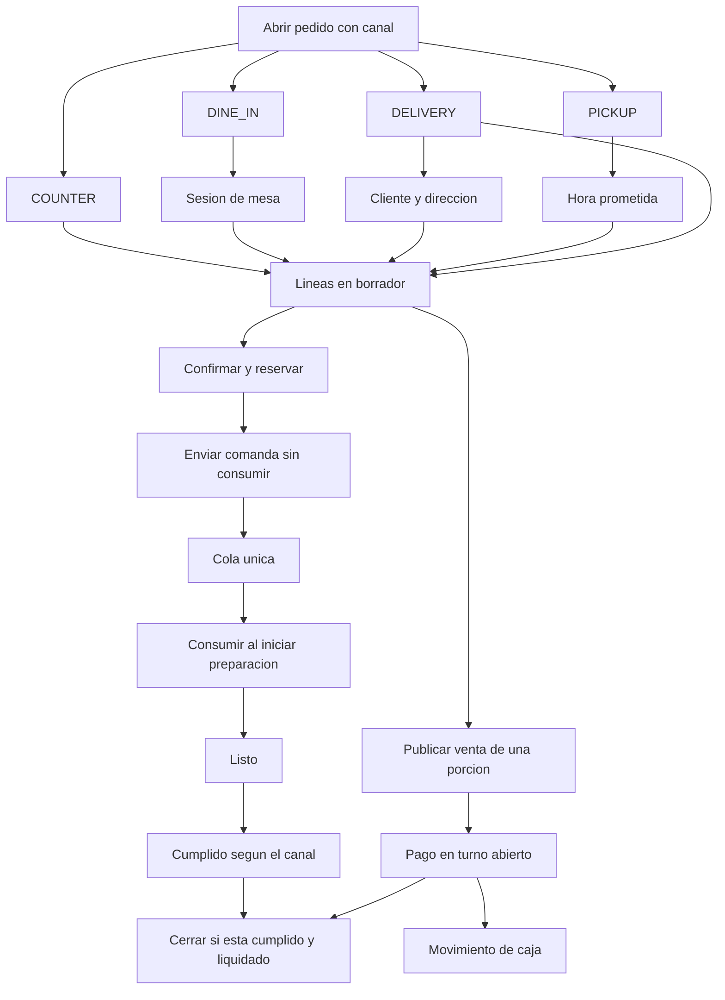
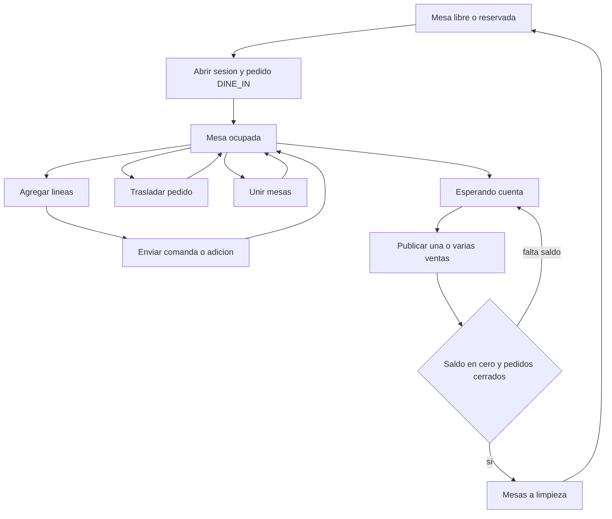
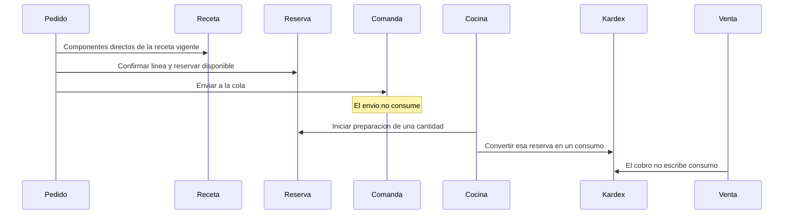
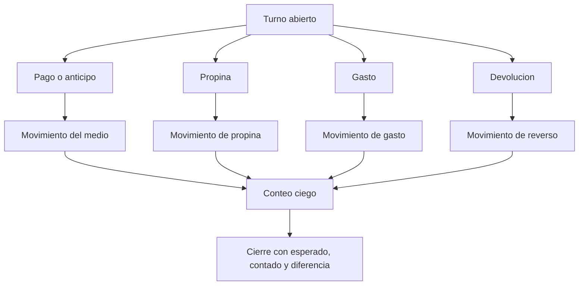

# Arquitectura técnica

Estado: **Propuesto**. Revisión: 2026-11-06, operación mixta.

La pila no cambia: Next.js, NestJS, PostgreSQL, Prisma y Zod, en un monolito modular. No hay autorización de código.

Desde el 2026-11-07, `TECHNICAL_MODEL_APPROVAL.md` está `APPROVED` y manda sobre las frases anteriores que incluían la propina en la venta, consumían al enviar la comanda o cerraban la caja con una sola diferencia. Esas frases quedan en el historial. La Fase 1 sigue `NOT AUTHORIZED`.

## 1. Módulos

| Módulo | Responsabilidad |
| --- | --- |
| `organization` | Organización, sede, caja, estación |
| `identity` | Usuario, rol, permiso por sede, sesión, PIN, auditoría |
| `catalog` | Categorías, productos, variantes, modificadores, precios |
| `inventory` | Insumos, unidades, saldo, reserva, kardex |
| `recipes` | Receta, subreceta, explosión y costo teórico |
| `purchasing` | Proveedor, orden, recepción, obligación, gasto |
| `orders` | Pedido, líneas, eventos, políticas de canal, cumplimiento |
| `floor` | Salas, mesas, sesiones, traslado y unión |
| `kitchen` | Comandas e historial. Estación lista para crecer |
| `billing` | Venta inmutable, división y anulación de venta |
| `payments` | Pagos, anticipos, asignación a una venta |
| `cash` | Turno, movimientos, arqueo |
| `customers` | Cliente y direcciones |
| `reporting` | Lecturas. No crea movimientos |

`orders` es el único dueño del ciclo operativo del pedido. `COUNTER`, `DINE_IN`, `DELIVERY` y `PICKUP` son políticas de ese módulo: dicen qué datos exige el canal, cuándo puede enviarse a cocina y cuándo está cumplido. No son módulos de venta.

`billing` publica una venta a partir de líneas del pedido. `kitchen` no cobra. `cash` no descuenta insumos. `reporting` no corrige un turno.

## 2. Por qué cinco documentos

| Entidad | Se crea cuando | Se vuelve inmutable cuando | No significa |
| --- | --- | --- | --- |
| `Order` | Al abrir mostrador, mesa, domicilio o recogida | Nunca se borra. El estado cambia con eventos | Que ya se cobró o que ya se entregó |
| `KitchenTicket` | Al enviar líneas en borrador, al adicionar o al cancelar lo enviado | Al persistirse. Otro hecho es otra comanda o un evento | Que el plato fue entregado al cliente o que fue pagado |
| `Sale` | Al liquidar una porción cuyo total queda cubierto | Al publicarse | Que la cocina acaba de descontar el inventario |
| `Payment` | Al recibir dinero o al anticipar | El registro original no se edita. La devolución es otra fila | Que un datáfono o un banco autorizaron la tarjeta |
| `CashMovement` | Junto con el pago, la propina, el gasto, la apertura o la devolución | Al insertarse | Que el pedido quedó cumplido |

Separarlos permite una mesa abierta sin venta, una comanda ya cocinada sin pago, un anticipo de recogida sin venta, y una venta anulada sin borrar la comanda.

Un pedido puede tener muchas comandas, muchas ventas y muchos pagos. Una venta pertenece a un pedido. Un pago se asigna a una venta o queda como anticipo del pedido. Cada pago de turno genera movimientos de caja.

## 3. Flujo de los cuatro canales



El cumplimiento y la liquidación avanzan por caminos distintos. Pueden cruzarse en cualquier orden según el canal:

| Canal | Orden habitual | Cumplido cuando |
| --- | --- | --- |
| `COUNTER` | Cobrar y enviar en la misma acción de servicio, en una transacción coordinada | El pedido se entrega en mostrador |
| `DINE_IN` | Enviar por tandas, servir, pedir la cuenta, cobrar, cerrar | Lo enviado fue entregado a la mesa y lo cancelado quedó registrado |
| `DELIVERY` | Confirmar, reservar, cocinar, cobrar o anticipar, despachar, entregar | La entrega queda marcada entregada |
| `PICKUP` | Confirmar con hora, reservar, cobrar o anticipar, cocinar cerca de la hora, entregar en el local | El cliente recoge |

Listo en cocina no despacha un domicilio ni cierra una mesa.

## 4. Transiciones

### Pedido, cumplimiento

`DRAFT` → `OPEN` → `IN_PREPARATION` → `READY` → `FULFILLED`

`DRAFT` o `OPEN` pueden pasar a `CANCELLED` si no hay consumo pendiente de compensar. Con consumo, la cancelación compensa cada línea y luego el pedido queda `CANCELLED`. `FULFILLED` y `CANCELLED` no se reabren.

`IN_PREPARATION` puede pasar a `FULFILLED` en mostrador cuando la entrega al cliente no necesita una pantalla intermedia de “listo”. El estado `READY` sigue existiendo para salón, domicilio y recogida.

### Pedido, liquidación

Se proyecta en la misma transacción que publica o anula una venta:

- `UNPAID`: no hay venta publicada ni anticipo aplicado.
- `PARTIALLY_PAID`: hay anticipo o una venta que no cubre todas las líneas activas.
- `PAID`: las ventas publicadas cubren las líneas activas y no queda saldo.
- `VOID`: las ventas quedaron anuladas y los pagos devueltos.

### Línea

`DRAFT` → `SENT` → `IN_PREPARATION` → `READY` → `HANDED_TO_SERVICE` → `FULFILLED`

Desde `DRAFT`, cancelar no mueve stock. Desde `SENT` en adelante, cancelar exige el compensatorio de inventario. Una línea `FULFILLED` puede seguir sin venta.

### Comanda

`QUEUED` → `IN_PREPARATION` → `READY` → `HANDED_TO_SERVICE`

`CANCELLED` conserva la comanda y el motivo. `HANDED_TO_SERVICE` significa que salió de cocina hacia el mesero, el mostrador o el despacho. No significa entregado en la dirección del cliente.

### Entrega

`PENDING` → `READY` → `DISPATCHED` → `COMPLETED`

`PICKUP` no usa `DISPATCHED`. Usa `READY` y después `COMPLETED` o `NO_SHOW`. `DELIVERY` solo llega a `COMPLETED` desde `DISPATCHED`.

### Mesa

`FREE` o `RESERVED` → `OCCUPIED` → `AWAITING_BILL` → `CLEANING` → `FREE`

`AWAITING_BILL` puede volver a `OCCUPIED` si la mesa sigue pidiendo.

### Venta y pago

La venta nace `POSTED`. Su anulación crea el registro de anulación; no devuelve la venta a borrador. El pago nace `RECORDED`. Su devolución es otro pago o un movimiento de reverso, y el original pasa a `VOIDED` sin borrarse.

## 5. Mesas y cuentas



La cuenta es la sesión más sus pedidos. La división son varias ventas del mismo pedido. Unir mesas no fusiona líneas dentro de un solo texto: reúne pedidos bajo una sesión principal.

## 6. Inventario y recetas



Este diagrama describe la regla `APPROVED` del 2026-11-07, no la ADR-016.

### Regla de stock ya aprobada

Si el disponible no alcanza, la transacción no reserva ni consume nada. La excepción exige usuario autorizado, PIN, motivo, cantidad autorizada y auditoría. Solo ese camino puede dejar la existencia por debajo de cero, y el kardex lo muestra. Un negativo sin ese registro no es un resultado válido.

### Preparaciones, requisito aprobado

Un plato no estalla hasta los ingredientes crudos si usa una preparación. Hogao, salsas, guacamole, ají o carne preparada son ítems de inventario con receta propia.

Producir un lote descuenta los componentes de esa receta, aplica el rendimiento y la merma de producción, y entra la cantidad resultante de la preparación. Vender o empezar a preparar el plato descuenta la preparación, no otra vez sus ingredientes. Si no hay preparación disponible, el plato se bloquea hasta producir un lote o hasta usar la excepción autorizada.

El lote de producción no es el lote de compra ni el vencimiento de proveedor. Esos siguen fuera del alcance aprobado.

### Reserva y consumo, regla propuesta

Estado: `APPROVED`. La ADR-016 permanece en el historial. La regla vigente es la de esta sección.

| Momento | Existencia | Disponible | Merma |
| --- | --- | --- | --- |
| Línea en borrador | No cambia | No cambia | No |
| Línea confirmada | No cambia | Baja por la reserva de los componentes directos | No |
| Comanda enviada | No cambia | No cambia otra vez | No |
| Cocina inicia la preparación de una cantidad | Baja al convertir esa reserva en consumo | La reserva de esa cantidad se cierra | No |
| Cancelación antes de preparar | No cambia | La reserva se libera | No |
| Cancelación después de iniciar | El consumo ya hecho permanece | No se libera solo | Solo si alguien registra una pérdida real |

La validación técnica encuentra la propuesta viable si se cierra así:

- La unidad de consumo es la cantidad de la línea que pasa a preparación, no el pedido entero. Si la cocina empieza dos platos de tres, solo esos dos se consumen.
- En mostrador, confirmar e iniciar preparación en la misma acción es una transacción. Hay una reserva y una conversión, y un solo consumo.
- La llave de idempotencia del consumo es el inicio de preparación, no el envío de la comanda. Repetir el inicio no descuenta otra vez.
- La foto de costo se toma en ese consumo, no al enviar la comanda. La venta copia esa foto. Esto ajusta la ADR-022, que sigue `PROPOSED`.
- Una reserva que la cocina no inicia sigue reteniendo disponible hasta cancelar la línea. No hay liberación automática por tiempo.
- El punto 7 de la regla pedida, “registrar la merma cuando corresponda”, se lee con la regla ya `APPROVED`: la cancelación no crea la merma. El consumo queda. La merma o el reintegro los escribe una persona cuando identifica el resultado físico.
- Los componentes reservados y consumidos son los directos de la receta vigente. Si el plato lleva hogao, se reserva hogao.

Con esas condiciones, la propuesta no contradice el bloqueo de stock, la merma independiente ni la producción de preparaciones. Sin ellas, el inicio de preparación de una línea consumiría todo el pedido, o una cancelación fabricaría una merma.

Cobrar no consume. La tarifa de domicilio es un cargo de dinero, sin receta. El modificador que agrega un componente entra en la reserva. El que solo cambia el precio no mueve stock.

Recepción de compra, producción, ajuste, conteo, merma y reverso son movimientos distintos, cada uno con documento origen y llave propia.

## 7. Caja



El esperado lo calcula el servidor al cerrar, sumando los movimientos del turno. La pantalla de conteo no lo recibe antes. Un turno cerrado rechaza movimientos. La diferencia queda registrada, sin ajustar el efectivo por detrás.

El pago mixto son varios pagos de una misma venta, cada uno con su movimiento. La suma debe cubrir el total de esa venta y la propina declarada.

## 8. Concurrencia

Sobre el pedido: bloqueo de fila y versión. Si la versión no coincide, la transacción no escribe.

Sobre el stock: bloqueo de las filas de saldo ordenadas por insumo. Así dos comandas concurrentes hacen cola sobre el mismo insumo y no se pierden actualizaciones ni se bloquean en círculo.

Sobre el turno: el movimiento solo se inserta si el turno sigue abierto dentro de la transacción.

La llave de idempotencia es única por sede y operación en crear pedido, enviar comanda, publicar venta, registrar pago, anular, confirmar recepción, confirmar conteo y cerrar turno.

## 9. Crecimiento que el modelo ya contempla

| Necesidad futura | Cómo queda preparada | Qué no se construye ahora |
| --- | --- | --- |
| Otra sede | `branch_id` en pedido, saldo, mesa, caja, usuario y reporte | Pantalla consolidada |
| Otra caja | Varias cajas por sede, un turno abierto por caja | Operar dos cajas a la vez |
| Inventario por sede | Saldo por sede e insumo | Traslados entre sedes |
| Permisos por sede | Asignación de rol por sede | Roles editables por el usuario final |
| Mesas por sede | Sala y mesa pertenecen a la sede | Mapa gráfico avanzado más allá de la distribución básica |
| Estaciones | `PrepStation` y `stationId` en la comanda. Producto con estación sugerida | Pantallas, sonidos y tiempos por estación |
| Canal externo | El canal del pedido admite un valor nuevo | Conectores |
| Factura DIAN | La venta es inmutable e independiente del documento fiscal | Proveedor tecnológico |
| Offline | UUID e idempotencia | Cola local y conflictos |
| Reportes de varias sedes | Las filas ya están partidas por sede | Consulta consolidada |

## 10. Estructura prevista del código, cuando se autorice

```text
apps/
  web/
  api/src/
    organization/
    identity/
    catalog/
    inventory/
    recipes/
    purchasing/
    orders/
    floor/
    kitchen/
    billing/
    payments/
    cash/
    customers/
    reporting/
    shared/
```

`shared` contiene dinero, cantidades, errores, identificador, transacción e idempotencia. Las políticas de canal viven en `orders`.

## 11. Seguridad del núcleo

El mesero opera pedidos de sus sesiones. El cajero cobra sobre un turno que tenga abierto. Bodega recibe compras y no publica ventas. Cocina avanza comandas y no ve costos ni caja. Descuento, anulación, merma de una línea ya preparada, ajuste de inventario y tratamiento de un no-show exigen permiso o PIN, y escriben auditoría.

Toda consulta operativa filtra por la sede de la sesión.

## 12. Lo que esta arquitectura todavía no decide

El modelo de impresora, la pasarela, el proveedor DIAN, el alojamiento y la política de negocio del anticipo por no-show. Esas decisiones no cambian las cinco entidades si se respetan los libros inmutables.
