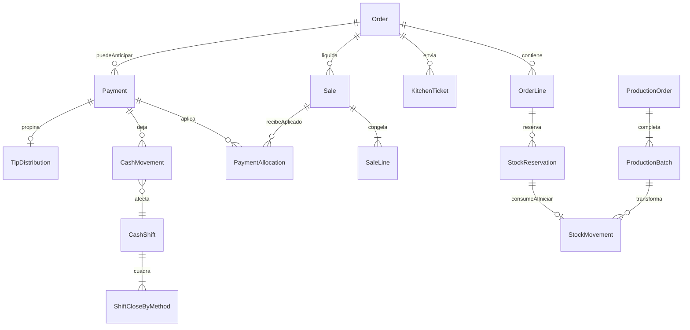
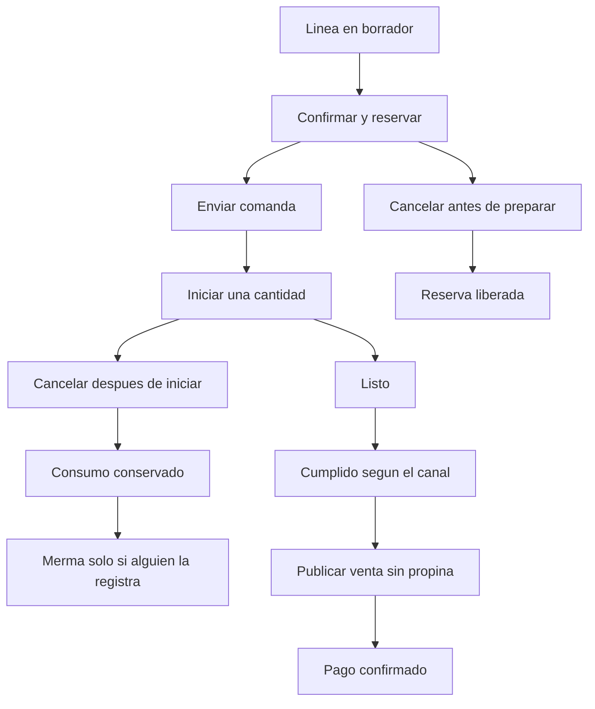
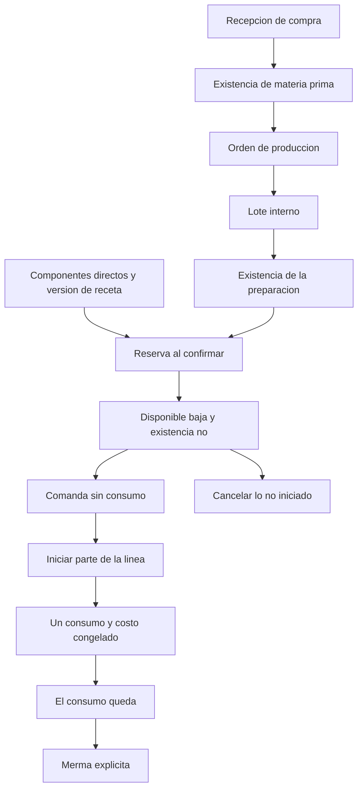
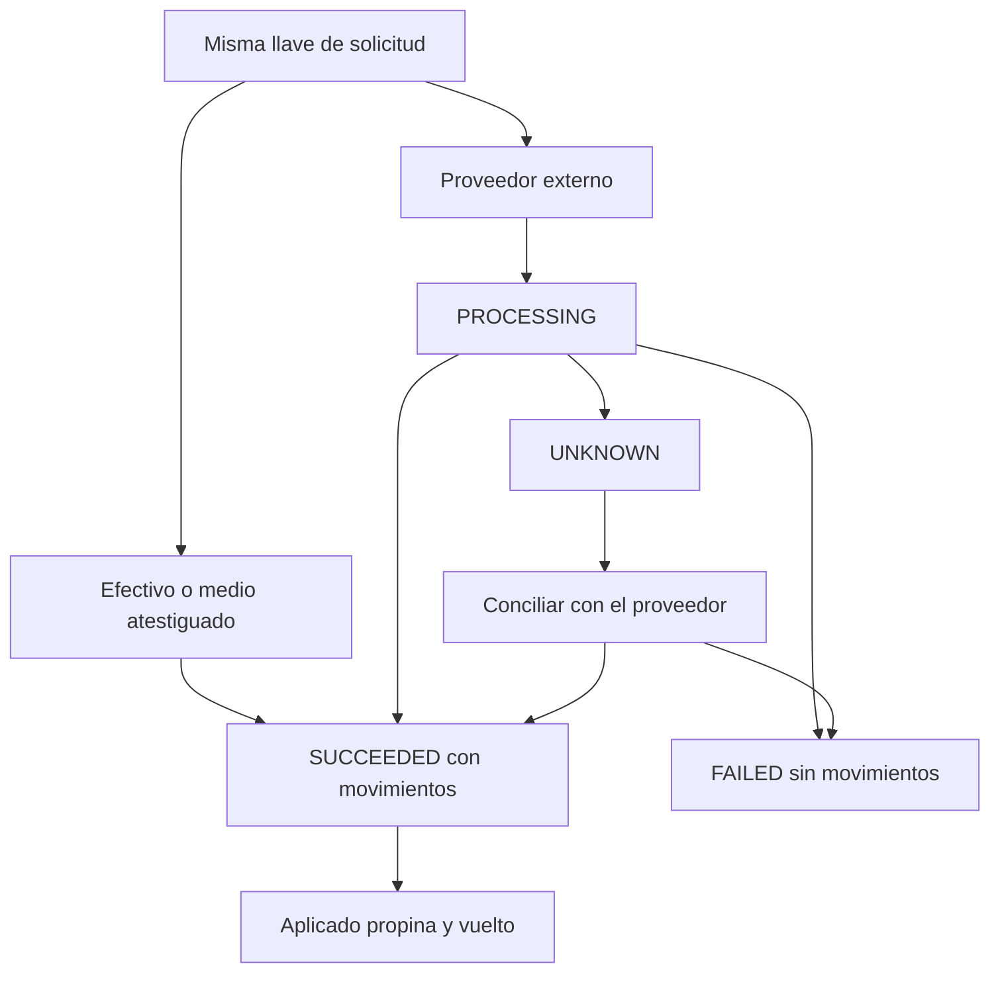
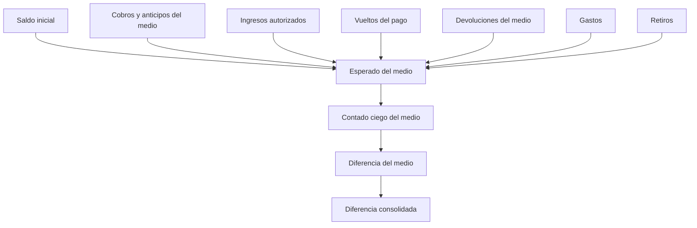

# Modelo técnico para aprobación

Estado: `APPROVED`. Fecha de aprobación: 2026-11-07.

Daniel aprobó este documento como contrato técnico y funcional de referencia del MVP mixto. La aprobación **no** autoriza la Fase 1, el código, las migraciones ni el despliegue.

Los detalles viven en `PAYMENT_AND_CASH_RULES.md`, `INVENTORY_RULES.md` y `ORDER_LIFECYCLE.md`. Las fichas ADR-037 a ADR-042 quedan `APPROVED` como parte de este contrato. El historial anterior no se borró. Cualquier cambio futuro exige una ADR nueva o una revisión formal.

## 0. Registro de aprobación

| Ítem | Estado |
| --- | --- |
| Fase 0 | `APPROVED` |
| Modelo técnico de este documento | `APPROVED` |
| Fase 1 | `NOT AUTHORIZED` |
| Código | No iniciado |
| Migraciones | No iniciadas |
| Despliegue | No autorizado |

### Alcance aprobado

Núcleo único de pedidos; mostrador, salón, domicilio y recogida; mesas; comandas; productos y modificadores; inventarios; reservas y consumo; recetas y subrecetas; producción por lotes; compras y proveedores; ventas; pagos; anticipos; propinas como dinero custodiado; caja y arqueos; auditoría; idempotencia; concurrencia; preparación para varias sedes y cajas.

### Excluidos de esta aprobación — `PENDING`

| Tema | Restricción de construcción |
| --- | --- |
| Tasas tributarias y configuración fiscal definitiva | Sin tasas inventadas. Cobro al público bloqueado hasta validación contable |
| Precios con impuesto incluido o excluido | El modo existe como dato. El valor no se elige |
| Validez del comprobante interno | Puede existir el tipo de documento. No se afirma cumplimiento legal |
| Distribución de propinas | El dinero se registra. El reparto queda pendiente sin responsable |
| Anticipos no reclamados | Sin retención automática, sin crédito a favor activo, sin cuenta corriente |
| Cantidad real de cajas físicas | El modelo admite varias. La semilla de desarrollo usa una caja marcada como de prueba |

### Condiciones técnicas adicionales — `APPROVED`

A. Un pago de tarjeta o transferencia registrado a mano no se presenta como confirmación bancaria si no hay integración con el proveedor.

B. Las reservas tienen seguimiento, antigüedad y alertas. No se liberan solas sin una política aprobada.

C. Toda excepción de inventario negativo exige autorización, motivo, responsable y auditoría, y aparece en los reportes.

## 1. Qué quedó aprobado en el modelo

- La propina fuera del ingreso del restaurante, con vuelto ligado al pago y sin sumar el dinero dos veces.
- El arqueo por medio, con diferencia de cada medio y una diferencia consolidada.
- La llave de idempotencia en la misma transacción del efecto local, y el estado `UNKNOWN` solo para un proveedor externo.
- El anticipo separado de la venta, sin retención automática y sin cuenta corriente.
- Reservar al confirmar, consumir al iniciar la cantidad de la línea y congelar el costo en ese consumo.
- La orden de producción distinta de la compra y del lote de proveedor.

## 2. Entidades

`Sale` no tiene propina. `Payment` parte el dinero en aplicado, propina y vuelto. `CashMovement` es la única cifra que entra al arqueo.

## 3. Pedido

Mostrador puede unir confirmar e iniciar en una sola transacción. Salón, domicilio y recogida usan los mismos estados. Domicilio listo no está entregado. Recogida guarda la hora prometida desde la confirmación.

## 4. Inventario

La compra no crea un lote de producción. El lote de producción no es un vencimiento de proveedor. Esos vencimientos siguen fuera. Las reservas tienen antigüedad y alerta. No hay liberación automática.

## 5. Pagos

Perder la respuesta del efectivo repite la misma llave. Perder la respuesta del proveedor deja `UNKNOWN`. Un timeout no se registra como fallo. La tarjeta o transferencia del MVP, sin proveedor, se muestra como registro local atestiguado, nunca como confirmación bancaria.

## 6. Caja

## 7. Reglas transaccionales

- Confirmar líneas reserva una sola vez, con la foto de la receta.
- Iniciar una cantidad consume solo esa cantidad y congela el costo.
- Confirmar e iniciar en mostrador es una transacción y un consumo.
- Publicar la venta no mueve inventario ni incluye propina.
- El pago local, sus movimientos y la llave se confirman juntos.
- Aplicar un anticipo no vuelve a ingresar el dinero.
- Completar una producción consume componentes, registra merma de producción y entra solo la cantidad buena.
- Cerrar el turno guarda esperado, contado y diferencia por medio.
- Repetir la misma llave y el mismo cuerpo devuelve el mismo resultado.

## 8. Integridad

- `recibido = aplicado + propina + vuelto`.
- El vuelto pertenece a un pago en efectivo.
- La propina no forma parte de `saleTotalMinor`.
- Un pago que no está `SUCCEEDED` no tiene movimientos de caja.
- Una llave es única por sede y operación.
- No hay dos reservas activas para la misma porción de línea y componente.
- El consumo no supera la reserva ni la existencia, salvo la excepción auditada.
- La existencia negativa sin esa excepción no es un estado válido.
- Una orden de producción no referencia una recepción de compra como si fuera su origen.
- El turno cerrado no recibe movimientos.
- El anticipo no puede marcar el pedido como pagado.

## 9. Casos extremos

| Caso | Resultado del modelo |
| --- | --- |
| Billete mayor que la cuenta, con propina | El billete es lo recibido. La cuenta es lo aplicado. La propina y el vuelto salen de ese mismo pago |
| Timeout al cobrar en efectivo | La misma llave devuelve el pago confirmado o lo aplica una sola vez |
| Timeout de un proveedor | El pago queda `UNKNOWN`, fuera del arqueo, hasta conciliar |
| Se inicia un plato de una comanda de cuatro | Solo ese plato se consume |
| Se inician dos de cinco unidades | Se consumen dos. Tres siguen reservadas |
| Cambia la receta con reserva abierta | La reserva vieja no cambia |
| Cambia el modificador ya consumido | No hay otro descuento automático |
| Reserva que nadie cocina | Sigue apartada, con antigüedad y alerta, hasta cancelar o iniciar |
| Cliente no recoge y había anticipo | El dinero espera una resolución. No se retiene solo |
| Se anula una venta ya servida | Se devuelve el dinero aplicado. El consumo queda. La merma es otro acto |
| Se produce hogao y luego se vende el plato | El lote consumió los ingredientes. El plato consume hogao |

## 10. Pendientes que esta aprobación no cierra

| Tema | Estado |
| --- | --- |
| Tasas, y si el precio de carta ya incluye el impuesto | `PENDING` del contador |
| Si el comprobante interno sirve para operar | Validación contable `PENDING` |
| Reparto de la propina | `PENDING` del propietario |
| Qué hacer con el anticipo no recogido | `PENDING` |
| Cuántas cajas físicas hay | `PENDING` |
| Lotes y vencimientos de materia prima | Fuera del modelo activo |
| Proveedor de pagos y factura DIAN | Fuera de la construcción |

## 11. Siguiente paso

El plan de la Fase 1 está en `PHASE_1_EXECUTION_PLAN.md`. La construcción empieza solo con una autorización expresa posterior a este documento.
